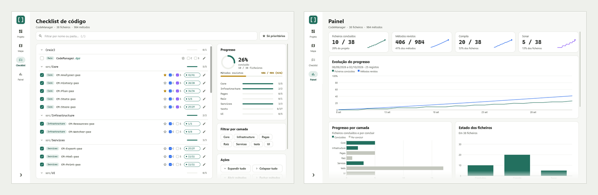
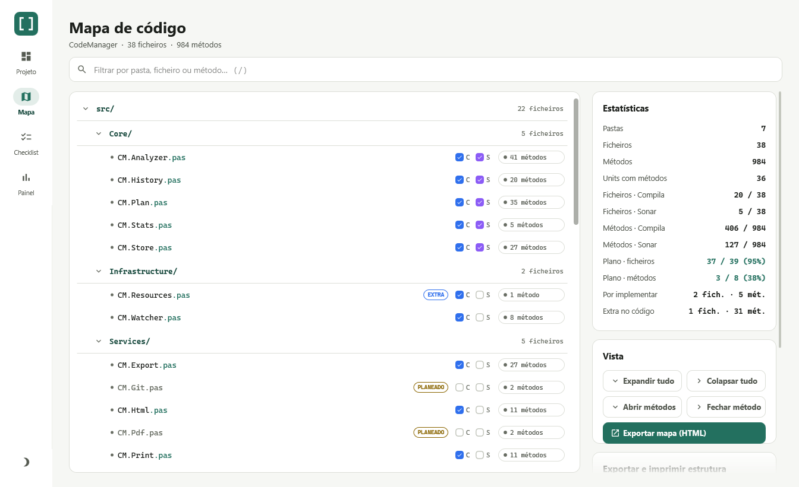
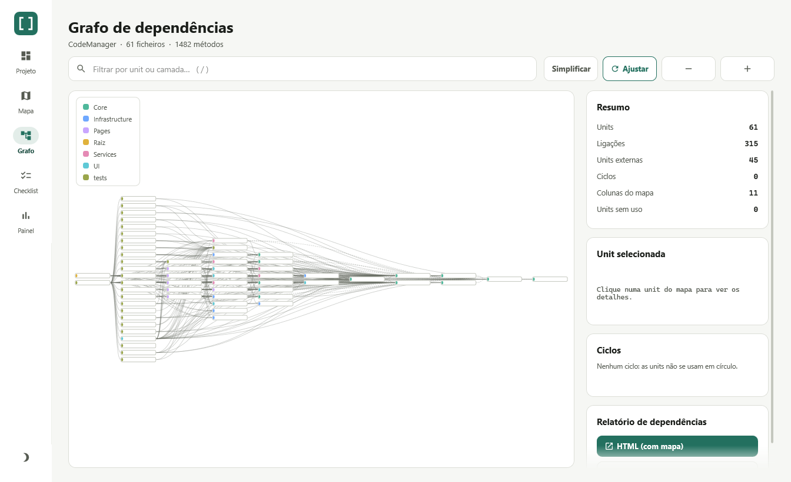
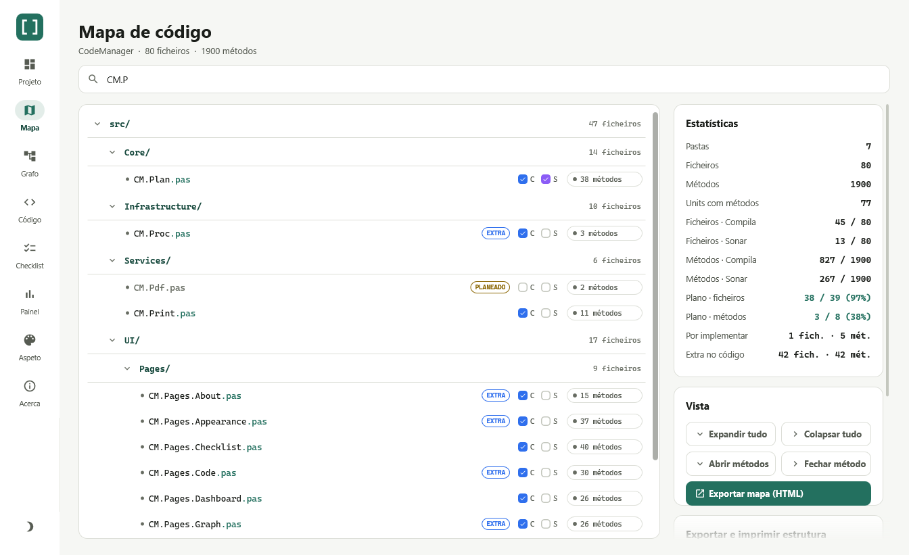
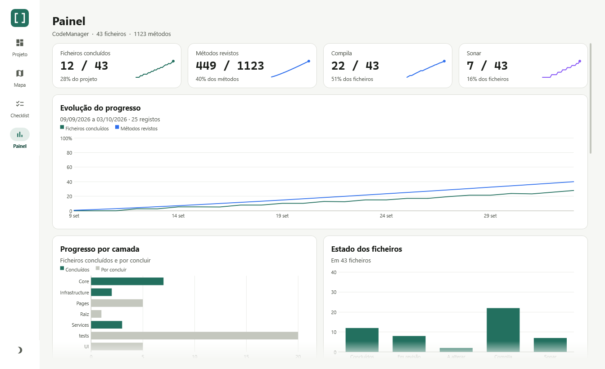
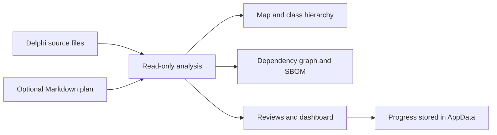

<div align="center">

# CodeManager

**Understand your Delphi code. Track quality. Make progress visible.**

[](docs/INSTALLATION.en.md)
[](docs/INSTALLATION.en.md)
[](LICENSE)
[](https://github.com/JFSF/CodeManager/releases/latest)

**English** · [Português](README.pt-PT.md)



</div>

CodeManager is a **free, open-source Delphi project analysis and code review tool** built with FireMonkey. Explore source code, inspect architecture and dependencies, review individual methods, and measure progress over time — **without changing the source files being analysed**.

Designed for developers maintaining, modernising, auditing or inheriting Delphi codebases. CodeManager runs as a **standalone Windows application**; it is not an IDE plugin.

## Why CodeManager?

- **Understand an unfamiliar codebase:** browse folders, units, methods, and their metrics.
- **Find architectural hotspots:** inspect `uses` dependencies, coupling and cycles; explore class inheritance depth.
- **Prioritise reviews:** track checked methods, notes, priorities and changes since a review.
- **Document dependencies:** export software bills of materials in CycloneDX 1.5 and SPDX 2.3 JSON.
- **Make progress visible:** dashboards and charts track complexity, distribution and review progress.
- **Compare plans with code:** use a Markdown specification to identify implemented, planned and extra elements.

## Screenshots

| Source code map | Dependency graph |
|---|---|
|  |  |

| Plan versus code | Dashboard |
|---|---|
|  |  |

<sub>The evolution history in the screenshots is demonstration data. Other views analyse CodeManager's own source.</sub>

## Features

| Area | Capabilities |
|---|---|
| **Source map** | Folders, files, methods, line counts, cyclomatic and cognitive complexity, parameters, nesting |
| **Class browser** | Classes, interfaces, records, ancestors, inheritance depth, direct descendants, declarations |
| **Dependency graph** | Visual unit relationships from `uses`, coupling, cycles, HTML/SVG and Markdown reports |
| **Review checklist** | Per-method review tracking, priority, notes, build/Sonar status and repository changes |
| **Source viewer** | Read-only Delphi syntax highlighting with line numbers and method navigation |
| **SBOM** | External unit inventory, provenance confidence, SHA-256, CycloneDX 1.5, SPDX 2.3 |
| **Dashboard** | Complexity hotspots, progress tracking, class depth, project overview and trends |
| **Plan comparison** | Markdown-driven intended structure versus implemented code |
| **Integrations** | Optional Git, Subversion, Mercurial and SonarQube integration |
| **Exports** | Markdown, TXT, CSV, JSON, offline HTML and printing/PDF |

The interface supports **Portuguese, English, French and German**, plus light and dark themes. Documentation coverage varies by language; the full user guide and detailed development documentation are currently in Portuguese.

## Quick start: download and run

1. Download `CodeManager-1.0.4-win64.exe` and `SHA256SUMS.txt` from the [latest release](https://github.com/JFSF/CodeManager/releases/latest).
2. Optionally verify the SHA-256 checksum using `Get-FileHash` on PowerShell.
3. Place the executable in a folder of your choice and launch it. No installer is required.
4. Open the **Project** page, choose a name and root folder, then select **Analisar projeto** (*Analyse project*).

**Runtime requirements:** Windows 10 or 11, 64-bit. Git, Subversion, Mercurial and SonarQube are optional. The published executable is currently **unsigned**, so Windows SmartScreen may display a warning. Download only from the official release page and verify the checksum before execution.

See [installation and build instructions (English)](docs/INSTALLATION.en.md).

## Build from source

**Build requirements:** RAD Studio / Delphi 13 (Win64 compiler), [Chart4D 1.2.0](https://github.com/GDKsoftware/Chart4D) installed via GetIt, and Windows 10/11.

```bat
git clone https://github.com/JFSF/CodeManager.git
cd CodeManager
build.bat Release Win64
```

Output: `out\bin\Win64\Release\CodeManager.exe`.

Chart4D is a **build-time source dependency**, compiled into the standalone executable; it is not a separately installed runtime requirement. For a nondefault Chart4D installation, set the `Chart4DDir` environment variable. See [build details](docs/INSTALLATION.en.md) and the [Portuguese development guide](docs/DESENVOLVIMENTO.md).

## How it works



CodeManager reads the project being analysed but does not edit its source code. Its own review status and preferences are saved separately in `%APPDATA%\CodeManager`. When configured, optional integrations may execute local version-control tools and communicate with a SonarQube server.

## Documentation

| Resource | Language |
|---|---|
| [Installation and building](docs/INSTALLATION.en.md) | English |
| [Contributing](docs/CONTRIBUTING.en.md) | English |
| [Full user guide](docs/GUIA-DO-UTILIZADOR.md) | Portuguese |
| [Development guide](docs/DESENVOLVIMENTO.md) | Portuguese |
| [Architecture](docs/ARQUITETURA.md) | Portuguese |
| [Markdown plan format](docs/FORMATO-DO-PLANO.md) | Portuguese |
| [Changelog](CHANGELOG.md) | Portuguese |
| [Third-party notices](THIRD-PARTY-NOTICES.md) | Portuguese |

## Releases and compatibility

The most recent published version at the time of this documentation update is **1.0.4**. See [GitHub Releases](https://github.com/JFSF/CodeManager/releases) for current binaries, checksums and release notes. The documented and tested build target is **Delphi 13 / Windows Win64**; other IDE versions and platforms are not claimed as supported.

## Contributing

Bug reports, feature requests, documentation improvements and pull requests are welcome. Start with the [English contribution guide](docs/CONTRIBUTING.en.md). For application code, follow the existing Portuguese coding conventions and run the DUnitX test suite.

## License and acknowledgements

CodeManager is released under the [MIT License](LICENSE). The application uses [Chart4D](https://github.com/GDKsoftware/Chart4D) and acknowledges other sources of inspiration and dependencies in [THIRD-PARTY-NOTICES.md](THIRD-PARTY-NOTICES.md).
